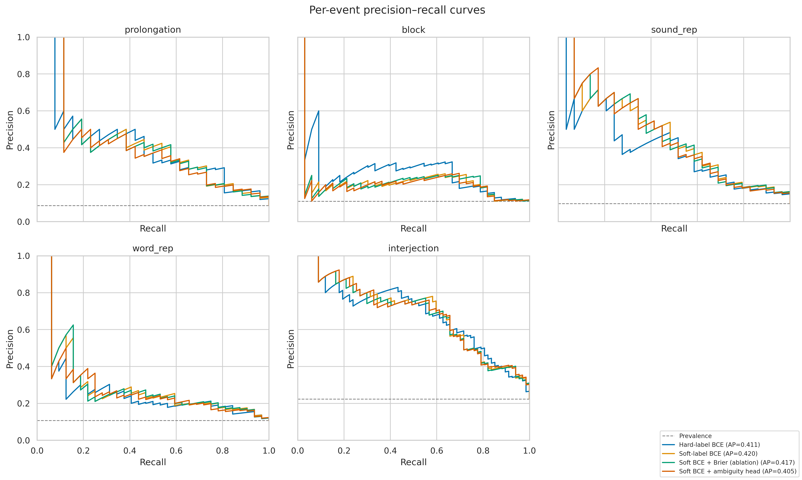
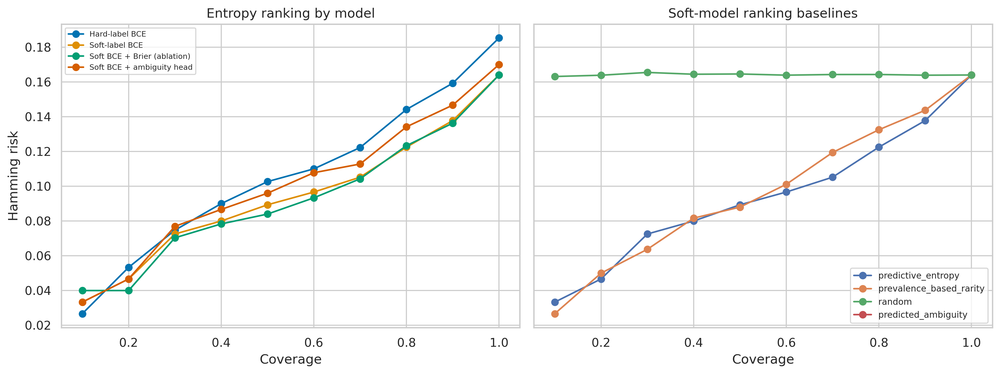

# StutterSense

Annotator-aware, multi-label stuttering-event detection with frozen WavLM representations. StutterSense evaluates hard majority-vote targets, soft annotator-proportion targets, Brier regularization, and an optional ambiguity-prediction head.

This is experimental research software, not a clinical diagnostic tool.

## Results

The completed v2 Colab experiment scanned all 21,856 hosted SEP-28k rows, sampled 2,000 clips with Algorithm R reservoir sampling, and trained four variants over three seeds. The split contained 1,400 training, 300 validation, and 300 test clips.

Validation-selected test metrics are reported as mean ± standard deviation across seeds 42, 123, and 456.

| Model | Macro F1 | Micro F1 | Macro AUROC | Macro AP | Soft Brier ↓ |
|---|---:|---:|---:|---:|---:|
| Hard BCE | 0.414 ± 0.006 | 0.441 ± 0.015 | 0.801 ± 0.002 | 0.411 ± 0.002 | 0.0641 ± 0.0010 |
| Soft BCE | 0.421 ± 0.017 | 0.448 ± 0.009 | 0.803 ± 0.002 | 0.422 ± 0.001 | 0.0609 ± 0.0005 |
| BCE + Brier ablation | **0.432 ± 0.025** | **0.458 ± 0.016** | **0.803 ± 0.002** | **0.423 ± 0.003** | 0.0610 ± 0.0005 |
| Ambiguity multi-task | 0.423 ± 0.013 | 0.447 ± 0.005 | 0.797 ± 0.002 | 0.417 ± 0.005 | **0.0608 ± 0.0004** |

The Brier ablation produced the highest mean F1 but also the largest seed variation. Primary-seed paired-bootstrap intervals for F1 differences versus hard BCE all included zero, so the experiment does not establish a reliable F1 advantage for an alternative objective. Soft-label variants did improve agreement with annotator-proportion targets.

Validation-selected thresholds improved mean macro F1 by 0.153–0.178 over a fixed threshold of 0.5. Interjection was the strongest event class (mean F1 0.608); block (0.324) and word repetition (0.285) remained the most difficult.

No verified speaker or episode identifiers were available in the hosted schema. The split prevents exact-duplicate leakage but is not verified as speaker-independent.

| Precision–recall | Risk–coverage |
|---|---|
|  |  |

The figures show the primary seed. Multi-seed tables, configuration, provenance, sample manifest, thresholds, and bootstrap intervals are in [`results/v2/`](results/v2/README.md). The earlier single-seed report remains in [`results/`](results/README.md).

## Method

Five event targets are derived from three annotation votes:

```text
hard target      = 1[count >= 2]
soft target      = count / 3
ambiguity target = 1[count in {1, 2}]
```

The experiment includes:

- full-stream, without-replacement reservoir sampling;
- pinned dataset and WavLM revisions;
- duplicate-aware or verified-group splitting;
- fixed and validation-selected per-event thresholds;
- per-event PR, AP, confusion, calibration, and error analysis;
- ambiguity, entropy, prevalence, and random risk–coverage baselines;
- multi-seed training and paired dependence-group bootstrap intervals;
- diagnostic annotation subgroup analysis;
- a manifest-gated external FluencyBank pathway.

The BCE+Brier model is a regularization ablation, not a separate uncertainty model.

## Run the full notebook in Google Colab

[`StutterSense_v2.ipynb`](StutterSense_v2.ipynb) is self-contained and does not require Google Drive or a repository clone.

1. Download or upload `StutterSense_v2.ipynb` to [Google Colab](https://colab.research.google.com/).
2. Select **Runtime → Change runtime type → GPU**. An A100 is fastest; a T4 also works but takes longer.
3. Select **Runtime → Run all**.
4. Download the generated `stuttersense_v2_outputs.zip` from the final output link.

The default configuration samples 2,000 clips and trains all four variants over three seeds. It downloads the pinned dataset revision and WavLM weights into the fresh Colab runtime.

## Run locally

Python 3.11 is recommended.

```bash
git clone https://github.com/ad-srvn/StutterSense.git
cd StutterSense
python3.11 -m venv .venv
source .venv/bin/activate
python -m pip install --upgrade pip
python -m pip install -r requirements-v2.txt -r requirements-dev.txt
```

Run the lightweight synthetic checks:

```bash
python scripts/validate_repo.py
python scripts/validate_v2.py
python -m unittest discover -s tests -v
```

Run the modular smoke or full pipeline:

```bash
python run_v2.py --config configs/v2_smoke.json --device cpu
python run_v2.py --config configs/v2_full.json --device cuda
```

The full command downloads SEP-28k and WavLM. See [`docs/v2_usage.md`](docs/v2_usage.md) for configuration and resume instructions.

## Repository layout

```text
StutterSense_v2.ipynb   Self-contained three-seed Colab experiment
StutterSense.ipynb      Original single-seed notebook
stuttersense_v2/        Modular training, evaluation, and inference package
configs/                Pinned smoke and full-run configurations
results/v2/             Curated multi-seed metrics and provenance
results/figures/        Primary-seed publication figures
tests/                  Synthetic unit and smoke tests
scripts/                Repository and notebook validation
docs/                   Usage and identity-manifest documentation
```

Generated checkpoints, embedding caches, output ZIP files, virtual environments, and local run directories are intentionally excluded from version control.

## Data and licensing

The experiment uses [`psusac/sep28k`](https://huggingface.co/datasets/psusac/sep28k) at the revision recorded in [`dataset_provenance.json`](results/v2/dataset_provenance.json). The [official SEP-28k release](https://github.com/apple-aiml-research/ml-stuttering-events-dataset) lists CC BY-NC 4.0 for the dataset; original audio remains copyrighted by podcast owners. Project code is MIT-licensed, while third-party data, audio, and model weights retain their own terms. WavLM terms are available on the [`microsoft/wavlm-base-plus`](https://huggingface.co/microsoft/wavlm-base-plus) model card.

External FluencyBank evaluation is disabled unless authorized audio and a verified identity manifest are provided. Access requirements are documented by [TalkBank](https://talkbank.org/fluency/access.html).

```bibtex
@inproceedings{lea2021sep28k,
  title={SEP-28K: A Dataset for Stuttering Event Detection from Podcasts with People Who Stutter},
  author={Lea, Colin and Mitra, Vikramjit and Joshi, Aparna and Kajarekar, Sachin and Bigham, Jeffrey P.},
  booktitle={ICASSP},
  year={2021}
}
```

See [`CONTRIBUTING.md`](CONTRIBUTING.md) for development guidance and [`LICENSE`](LICENSE) for the project license.
